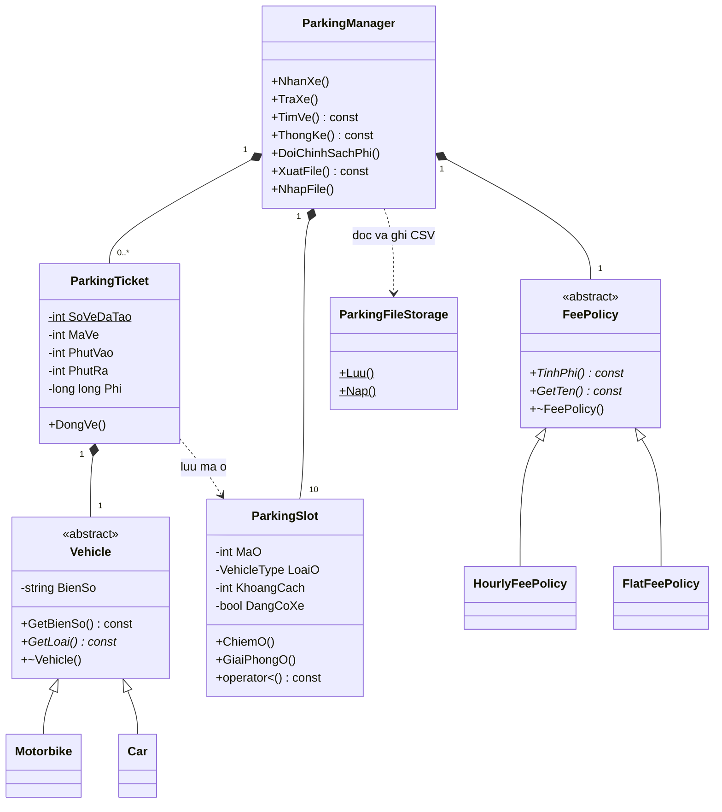

# Quản lý bãi đỗ xe — OOP C++ Console

Ứng dụng hoàn chỉnh theo `Roadmap_OOP_QuanLyBaiDoXe_Console.md`, sử dụng C++11, nhập liệu bằng bàn phím và lưu dữ liệu lâu dài bằng file CSV. Mã nguồn được tách thành 13 file `.h`/`.cpp` trong thư mục `ParkingOOP`, không cần công cụ build hay thư viện bên ngoài. Hai file bổ sung `ParkingFileStorage.h/.cpp` phụ trách đọc, kiểm tra và ghi dữ liệu.

## Biên dịch và chạy

Mở PowerShell tại thư mục dự án, chuyển vào thư mục mã nguồn:

```powershell
Set-Location .\ParkingOOP
```

Biên dịch bằng một lệnh:

```powershell
g++ -std=c++11 -Wall -Wextra main.cpp Vehicle.cpp ParkingSlot.cpp ParkingTicket.cpp FeePolicy.cpp ParkingManager.cpp ParkingFileStorage.cpp -o ParkingOOP.exe
```

Chạy khi biên dịch thành công:

```powershell
.\ParkingOOP.exe
```

Môi trường: MinGW.org GCC **6.3.0**, Windows PowerShell. Chương trình dùng tiếng Việt không dấu trên console để hiển thị ổn định với terminal Windows cũ. File mặc định `parking_data.csv` nằm cạnh file thực thi trên Windows; chương trình hiển thị đường dẫn khi mở. Lần chạy đầu tạo dữ liệu bãi trống; những lần sau tự khôi phục phiên trước.

## Chức năng

- **1 — Danh sách ô:** xem mã ô, loại xe, khoảng cách đến cổng, trạng thái trống/đã có xe.
- **2 — Nhận xe:** chọn `1` cho xe máy hoặc `2` cho ô tô, nhập biển số và phút vào; hệ thống tự phân ô rồi cấp mã vé.
- **3 — Trả xe:** nhập mã vé và phút ra; tính phí, đóng vé, giải phóng ô và cộng doanh thu.
- **4 — Tra cứu:** tìm theo mã vé, gồm cả vé đã trả, hoặc tìm xe đang gửi theo biển số.
- **5 — Xe đang gửi:** xem các vé đang hoạt động.
- **6 — Thống kê:** tổng ô, ô trống, số xe đang gửi, tỷ lệ sử dụng chung và theo loại, lượt đã trả và doanh thu đã thu.
- **7 — Chính sách phí:** chọn theo giờ hoặc theo lượt; chọn `0` để giữ nguyên.
- **8 — Lịch sử:** xem vé đã đóng cùng thời gian và phí đã thu.
- **9 — Xuất file CSV/TXT:** nhập đường dẫn để sao lưu toàn bộ dữ liệu; để trống để hủy.
- **10 — Nhập file CSV/TXT:** đọc file đã xuất để thay thế toàn bộ dữ liệu bãi hiện tại; để trống để hủy. Dữ liệu được nạp chỉ khi cả file hợp lệ.
- **0 — Thoát.** Hết luồng nhập ở bất kỳ câu hỏi nào cũng thoát an toàn, lưu các thay đổi còn lại.

Menu báo nhập sai và cho nhập lại khi gặp chữ thay số, số quá lớn, số ngoài giới hạn hoặc dòng có ký tự thừa. Lỗi nghiệp vụ được thông báo rồi quay về menu.

## Lưu và khôi phục dữ liệu

Chương trình tự lưu sau mỗi lần **nhận xe, trả xe, đổi chính sách phí và nhập file thành công**. Toàn bộ ô đỗ, vé đang gửi, lịch sử, phí đã thu, chính sách và bộ đếm mã vé được lưu. Doanh thu được khôi phục từ tổng phí các vé đã trả. RAM vẫn được dùng để xử lý trong lúc chạy; file giữ dữ liệu qua các lần đóng/mở ứng dụng.

- Menu **9** tạo bản sao CSV, hoặc đặt tên như `sao_luu.txt`; cả hai dùng cùng cấu trúc văn bản phân cách bằng dấu phẩy.
- Menu **10** nạp bản sao đó. Việc nhập **thay thế**, không gộp với dữ liệu hiện tại, rồi tự lưu vào file chính đang sử dụng. Các mã vé cũ được giữ nguyên; mã mới tiếp tục tăng, không tái sử dụng mã đã cấp trong phiên chạy.
- Đường dẫn nhập từ bàn phím có thể là tuyệt đối hoặc tương đối với thư mục làm việc. Nhập đường dẫn trực tiếp, không bọc trong dấu nháy kép. Thư mục chứa file phải có sẵn.
- Nếu file sai định dạng, trùng mã vé, trùng biển số đang gửi, hai xe chiếm một ô, thời gian sai hoặc tổng tiền không khớp, thao tác nhập bị từ chối và giữ nguyên dữ liệu hiện có.
- File chính bị hỏng hoặc không đọc được lúc khởi động sẽ khiến chương trình báo lỗi và dừng, giữ nguyên file để có thể phục hồi. Có thể khởi động với đường dẫn file khác như ví dụ dưới đây.
- Khi ghi, chương trình ghi hoàn tất vào file tạm cùng thư mục rồi thay file đích. Nếu ghi thất bại, file cũ được giữ lại và chương trình báo rõ dữ liệu chưa được lưu. Có thể dùng menu 9 để sao lưu ở nơi khác; thoát khi vẫn không lưu được sẽ trả mã lỗi.

Có thể chọn file dữ liệu chính riêng bằng một tham số:

```powershell
.\ParkingOOP.exe "D:\du_lieu\bai_xe.csv"
```

File ví dụ `du_lieu_mau.csv` tại thư mục gốc dự án có một vé xe máy đã trả với phí `6.000 VND` và một ô tô đang gửi. Từ thư mục `ParkingOOP`, chọn menu **10** rồi nhập `..\du_lieu_mau.csv` để thử. Dữ liệu hiện tại sẽ được thay thế bằng dữ liệu mẫu; có thể xuất bản sao trước bằng menu 9.

Định dạng CSV có phiên bản, với các loại dòng:

```text
PARKING_OOP,1
POLICY,HOURLY
COUNTER,2
SLOT,101,MOTORBIKE,20
... các dòng SLOT còn lại, đủ 10 ô ...
TICKET,1,MOTORBIKE,29A-12345,102,480,555,6000,CLOSED
TICKET,2,CAR,30A-67890,202,600,-1,0,ACTIVE
END,10,2,6000
```

`POLICY` nhận `HOURLY` hoặc `FLAT`. Dòng `TICKET` lần lượt là loại bản ghi, mã vé, loại xe, biển số, mã ô, phút vào, phút ra, phí và trạng thái. Vé `ACTIVE` phải có phút ra `-1`, phí `0`; vé `CLOSED` chứa thời gian ra và phí thực tế đã thu. `END` chứa số ô, số vé và doanh thu để kiểm tra tính đầy đủ. Trạng thái chiếm ô được suy ra từ vé đang hoạt động. Dấu phẩy hoặc dấu nháy kép trong biển số được ghi theo quy tắc trích dẫn CSV. Đây là định dạng dữ liệu của ứng dụng, không phải mọi file CSV bất kỳ đều nhập được.

## Quy tắc đã triển khai

**Bãi ban đầu:** 6 ô xe máy mã `101–106`, khoảng cách lần lượt `20, 5, 12, 5, 30, 18` mét; 4 ô ô tô mã `201–204`, khoảng cách `25, 8, 8, 16` mét. Tất cả đều trống.

**Phân ô:** chỉ chọn ô trống đúng loại, gần cổng nhất; nếu bằng khoảng cách, ưu tiên mã ô nhỏ hơn. Vì vậy xe máy lần đầu nhận ô `102`, tiếp theo là `104`; ô tô lần đầu nhận ô `202`, tiếp theo là `203`. Xe máy không dùng ô ô tô ngay cả khi hết ô xe máy.

**Biển số:** bỏ khoảng trắng và chuyển thành chữ hoa trước khi lưu và tìm. Ví dụ ` 29a-12345 ` và `29A-12345` là cùng một biển số. Không chấp nhận biển số rỗng hoặc chỉ chứa khoảng trắng; không cho trùng biển số giữa hai vé đang hoạt động. Xe đã ra có thể vào lại với mã vé mới. Không mô phỏng kiểm tra mẫu biển số pháp lý.

**Thời gian:** số phút nguyên không âm từ một mốc chung: `480 = ngày 1, 08:00`; `555 = ngày 1, 09:15`; `1500 = ngày 2, 01:00`. Qua ngày tiếp tục đếm phút. Phút ra phải lớn hơn hoặc bằng phút vào. Không dùng đồng hồ thực của máy.

**Phí mô phỏng:** mặc định theo giờ, xe máy `3.000 VND/giờ`, ô tô `10.000 VND/giờ`. Làm tròn lên, tối thiểu một giờ, kể cả gửi `0` phút. Theo lượt: xe máy `8.000 VND/lượt`, ô tô `25.000 VND/lượt`. Áp dụng **chính sách đang chọn tại thời điểm trả xe**, kể cả đối với xe vào trước khi đổi chính sách.

**Trạng thái và doanh thu:** chỉ cộng tiền sau khi trả xe thành công. Trả vé đã đóng bị từ chối. Lỗi biển số, hết chỗ, mã vé, thời gian hoặc tính phí không làm mất ô, đóng vé hay tăng doanh thu. Lịch sử giữ phí đã thu, không tính lại theo chính sách mới. Cảnh báo xuất hiện khi tỷ lệ sử dụng toàn bãi **từ 80%**.

## Cấu trúc và thiết kế OOP

```text
ParkingOOP/
  Vehicle.h          Vehicle.cpp
  ParkingSlot.h      ParkingSlot.cpp
  ParkingTicket.h    ParkingTicket.cpp
  FeePolicy.h        FeePolicy.cpp
  ParkingManager.h   ParkingManager.cpp
  ParkingFileStorage.h  ParkingFileStorage.cpp
  main.cpp
```



Các điểm cần hiểu khi bảo vệ:

1. **Đóng gói:** trạng thái ô và vé là `private`; thay đổi qua `ChiemO`, `GiaiPhongO`, `DongVe` có kiểm tra điều kiện.
2. **Trừu tượng và kế thừa:** `Vehicle::GetLoai()` là hàm thuần ảo; `Motorbike`, `Car` ghi đè bằng `override`. Hàm hủy ảo bảo đảm hủy đúng đối tượng con qua con trỏ cha.
3. **Đa hình:** `ParkingManager::TraXe()` gọi `ChinhSachPhi->TinhPhi(...)`. Đổi đối tượng chính sách sẽ đổi công thức mà không phải sửa quy trình trả xe.
4. **`static`:** `ParkingTicket::SoVeDaTao` dùng chung cho mọi vé; `MaVe` thuộc từng đối tượng. Không sao chép vé để tránh tạo hai đối tượng cùng mã. Bộ đếm được lưu và khôi phục; nhập bản sao cũ không làm giảm bộ đếm hiện tại.
5. **Nạp chồng toán tử:** `ParkingSlot::operator<` mô tả thứ tự ưu tiên ô; `friend operator<<` in ô và vé. Thuật toán phân ô thực sự sử dụng `operator<`.
6. **Quyền sở hữu:** `unique_ptr<Vehicle>` trong vé giữ phương tiện cụ thể; `ParkingManager` sở hữu ô, vé đang gửi, lịch sử và chính sách. RAII tự giải phóng bộ nhớ, không có `delete` thủ công. Các con trỏ/tham chiếu chỉ đọc trả về từ manager chỉ dùng khi manager còn tồn tại và chưa nhập dữ liệu thay thế.
7. **Tách trách nhiệm và `const`:** `main.cpp` lo menu, phân tích dòng nhập và xuất kết quả; manager cùng các lớp dữ liệu giữ nghiệp vụ. Getter dùng `const`; không trả tham chiếu cho phép bên ngoài sửa trạng thái nội bộ.
8. **Lưu trữ và `friend`:** `ParkingFileStorage` là lớp chuyên đọc/ghi CSV, được khai báo `friend` để khôi phục dữ liệu đã kiểm tra mà không mở setter tùy ý cho mã vé. Constructor phục hồi là `private`, không tự tăng bộ đếm; chỉ cập nhật bộ đếm sau khi toàn bộ file hợp lệ.

Khi nhận xe, các kiểm tra và cấp phát cần thiết hoàn thành trước khi chiếm ô. Khi trả xe, việc kiểm tra thời gian, tính phí, kiểm tra tràn doanh thu và cấp chỗ cho lịch sử hoàn thành trước khi đóng vé. Điều này giữ trạng thái nhất quán nếu thao tác thất bại.

## Kịch bản demo 3–5 phút

1. Bắt đầu với file dữ liệu mới, ví dụ `.\ParkingOOP.exe demo_moi.csv` khi file này chưa tồn tại. Chọn `1`, xác nhận 10 ô trống và xem hai ô xe máy `102`, `104` cùng cách cổng 5 mét.
2. Chọn `2` → loại `1` → biển số `29A-12345` → phút vào `480`. Nhận vé `1`, ô `102`.
3. Chọn `4` → `1` → vé `1`; hoặc `4` → `2` → `29a-12345` để chứng minh tra cứu chuẩn hóa biển số.
4. Thử nhận lại cùng biển số khi vé còn hoạt động; chương trình báo trùng và không tạo vé mới.
5. Chọn `3` → vé `1` → phút ra `479`: báo thời gian không hợp lệ. Chọn `5` để xác nhận xe vẫn đang gửi.
6. Chọn `3` → vé `1` → phút ra `555`: gửi `75` phút, phí **6.000 VND**. Chọn `6` để xem 10 ô trống, doanh thu 6.000 VND; chọn `8` để xem lịch sử.
7. Thử trả lại vé `1`; doanh thu không tăng lần hai.
8. Nhận ô tô mới, chọn `7` → `2` để đổi sang theo lượt rồi trả xe; phí là **25.000 VND** dù xe vào lúc chính sách theo giờ.
9. Chọn `9`, xuất `sao_luu.csv`. Thoát, mở lại cùng file chính để thấy doanh thu và lịch sử còn nguyên. Chọn `10` để thử nạp lại bản sao.

Muốn demo cảnh báo, nhận đủ 6 xe máy và 2 ô tô với các biển số khác nhau: toàn bãi đạt `80%`. Nhận xe máy thứ 7 sẽ bị từ chối dù vẫn còn 2 ô ô tô.

## Kiểm tra trước khi nộp

Bản nền đã đạt **195 kiểm tra nghiệp vụ trong 14 nhóm và 20 kịch bản console**. Phiên bản lưu trữ đã đạt **176 kiểm tra trong 6 nhóm và 16 kịch bản console**, gồm 56 biến thể file lỗi, khởi động lại, tự lưu trước khi tiến trình bị dừng, ghi file bị khóa chỉ đọc và phục hồi từ bản sao. Build đầy đủ với `-Wall -Wextra -Wpedantic` không có cảnh báo. Các bộ kiểm thử tạm chạy riêng ngoài thư mục mã nguồn.

- Đa hình xe, bộ đếm vé, so sánh ô và chuyển trạng thái vé được kiểm tra riêng trước khi tích hợp.
- Kiểm tra toàn bộ ca T01–T15 trong roadmap: đúng loại/ô gần nhất, hòa khoảng cách, biển số trùng, hết ô theo loại, 75 phút thành 2 giờ, giờ ra sai, mã vé sai, trả hai lần, đổi chính sách, ngưỡng 80%, mã duy nhất, nhập chữ, trả hết xe và dữ liệu rỗng/âm.
- Bổ sung biên 0/60/61 phút, số phút tối đa của `int`, gửi qua ngày, biển số quay lại sau khi trả, lỗi chính sách phí và kết thúc luồng nhập giữa chừng.
- Build với C++11 trên g++ 6.3 và bật `-Wall -Wextra -Wpedantic`; kiểm tra ứng dụng bằng dữ liệu nhập tự động và đối chiếu kết quả, thay vì chỉ kiểm tra biên dịch.
- Xuất rồi nhập lại dữ liệu phải giữ đúng mã vé, ô có xe, lịch sử, phí, doanh thu và chính sách; khởi động lại phải cấp mã vé tiếp theo.
- Nhập file lỗi phải giữ nguyên trạng thái bãi và bộ đếm; ghi file thất bại phải giữ bản cũ. Kiểm tra thêm file trống, thiếu dòng kết thúc, dữ liệu trùng, số tràn và CSV có dấu phẩy/nháy kép.

Phạm vi dự án có lưu file CSV/TXT, không có cơ sở dữ liệu, GUI, tài khoản, cảm biến hay nhận diện biển số. Phần “thông minh” là quy tắc phân ô tự động và cảnh báo gần đầy.
