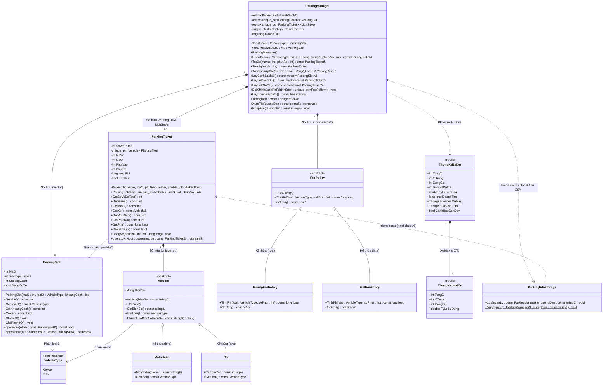
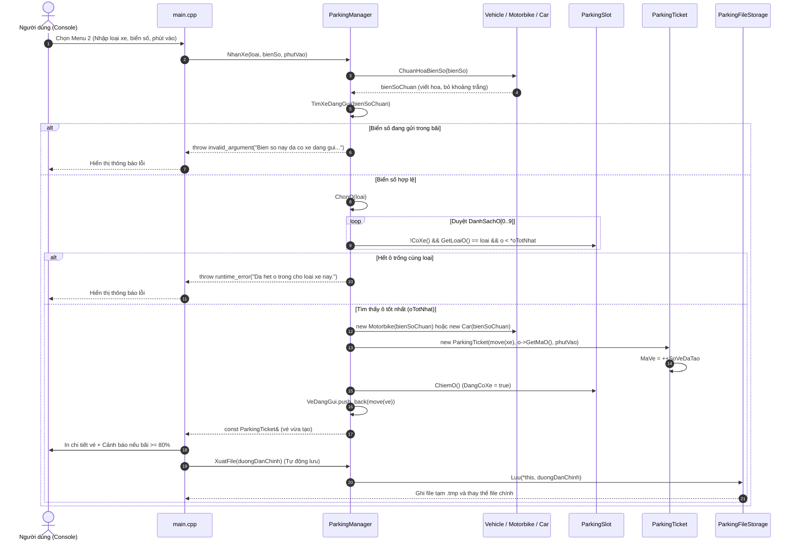
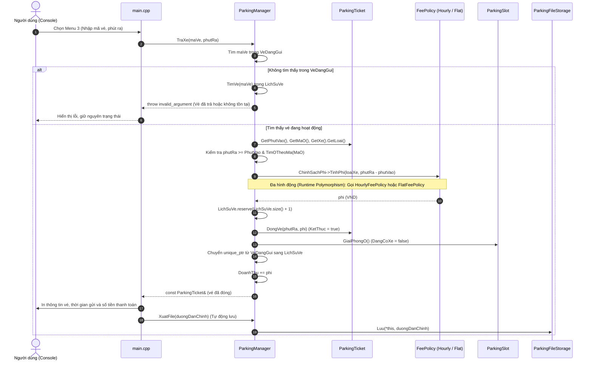
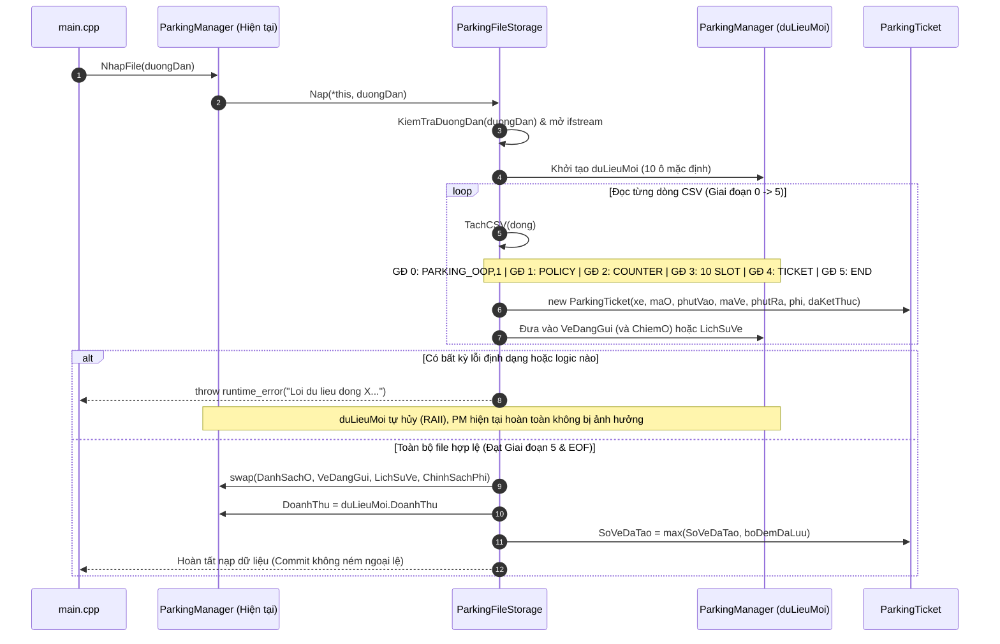
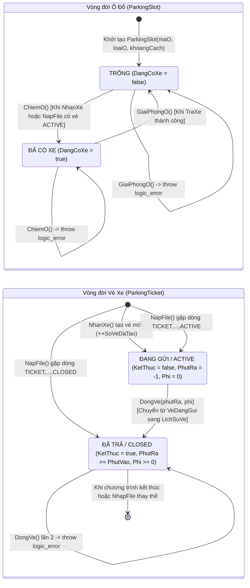
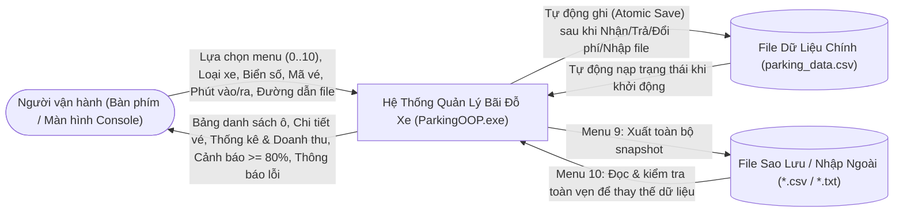
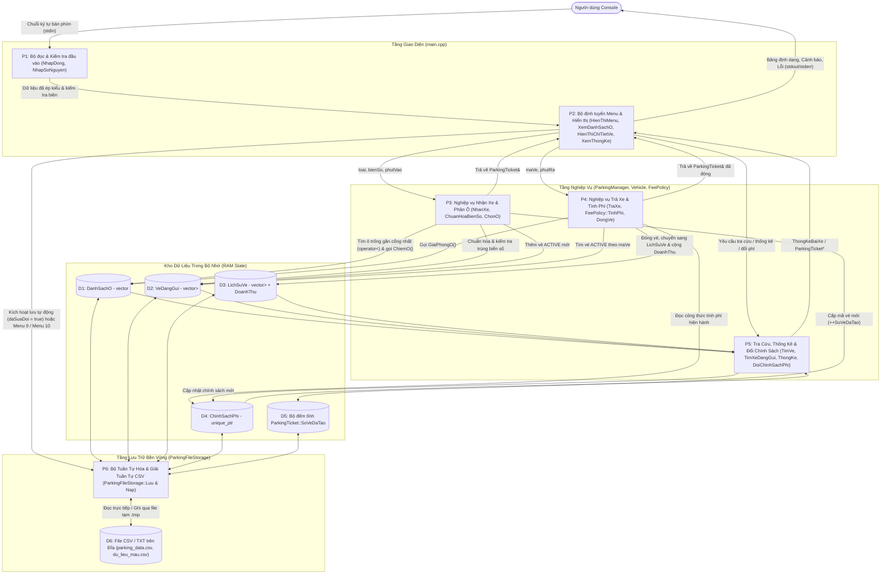
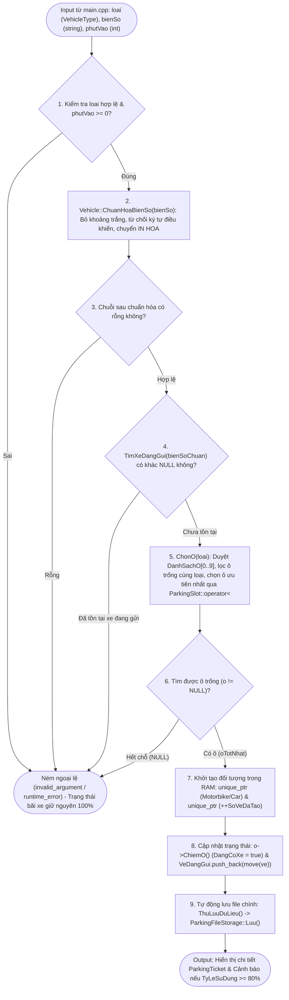
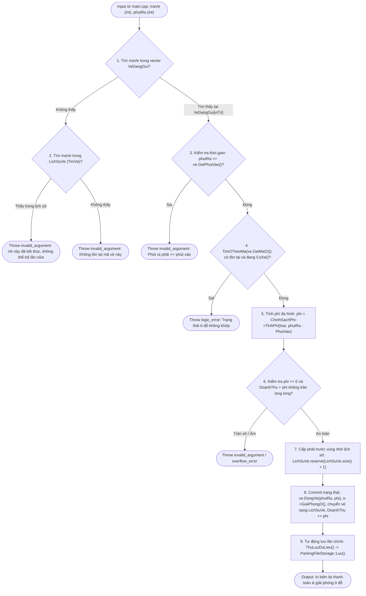
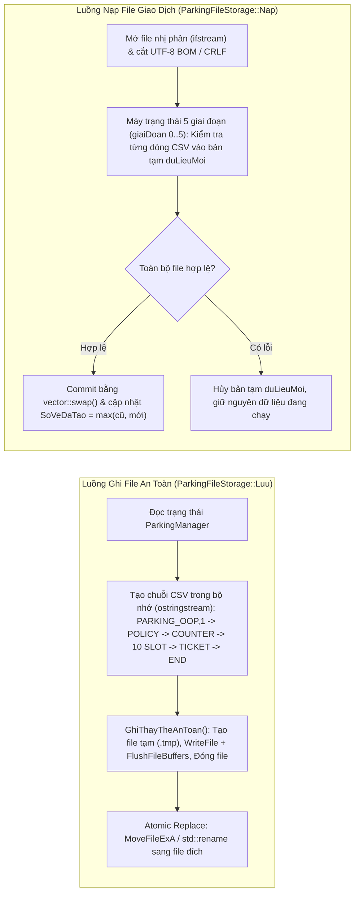

# Tài Liệu Thiết Kế UML & Luồng Dữ Liệu (Dataflow) — Dự Án Quản Lý Bãi Đỗ Xe OOP C++

Tài liệu này mô tả chi tiết kiến trúc hướng đối tượng (**UML**) và luồng di chuyển, biến đổi dữ liệu (**Dataflow Diagram - DFD**) của hệ thống **Quản lý bãi đỗ xe thông minh trên Console** (`ParkingOOP`).

---

## Phần 1: Hệ Thống Sơ Đồ UML (Unified Modeling Language)

### 1.1. Sơ Đồ Lớp Chi Tiết (UML Class Diagram)

Sơ đồ dưới đây biểu diễn toàn bộ các lớp, cấu trúc (`struct`), kiểu liệt kê (`enum class`), thuộc tính, phương thức và mối quan hệ thực tế trong mã nguồn:

> **Ghi chú ký hiệu:** Trong Mermaid Class Diagram ở trên, `operator~` đại diện cho `ParkingSlot::operator<` và `operator~~` đại diện cho toán tử luồng xuất `friend operator<<` tại `ParkingSlot.h` và `ParkingTicket.h`.

#### Bảng Phân Tích Quan Hệ Giữa Các Lớp

| Quan hệ OOP | Lớp nguồn -> Lớp đích | Biểu diễn trong Code | Ý nghĩa thiết kế |
|---|---|---|---|
| **Inheritance (Kế thừa)** | `Motorbike`, `Car` -> `Vehicle` | `class Motorbike : public Vehicle` | Tái sử dụng thuộc tính `BienSo` và chuẩn hóa biển số; đa hình qua hàm thuần ảo `GetLoai()`. |
| **Inheritance (Kế thừa)** | `HourlyFeePolicy`, `FlatFeePolicy` -> `FeePolicy` | `class HourlyFeePolicy : public FeePolicy` | Thực thi mẫu thiết kế **Strategy Pattern**: đóng gói thuật toán tính phí theo giờ và theo lượt. |
| **Composition (Hợp thành)** | `ParkingTicket` *-- `Vehicle` | `std::unique_ptr<Vehicle> PhuongTien` | Mỗi vé gắn chặt với duy nhất một phương tiện; khi vé bị hủy, phương tiện tự động được giải phóng (RAII). |
| **Composition (Hợp thành)** | `ParkingManager` *-- `ParkingSlot`, `ParkingTicket`, `FeePolicy` | `std::vector<ParkingSlot>`, `std::vector<std::unique_ptr<ParkingTicket>>`, `std::unique_ptr<FeePolicy>` | `ParkingManager` làm chủ toàn bộ vòng đời của các ô đỗ, vé đang gửi, lịch sử vé và chính sách phí hiện hành. |
| **Friendship (`friend`)** | `ParkingFileStorage` -> `ParkingTicket`, `ParkingManager` | `friend class ParkingFileStorage;` | Cho phép lớp lưu trữ gọi constructor `private` của `ParkingTicket` để khôi phục mã vé cũ và hoán đổi (`swap`) trạng thái `ParkingManager` mà không cần mở hàm `Setter` công khai phá vỡ tính đóng gói. |

---

### 1.2. Sơ Đồ Tuần Tự (UML Sequence Diagrams)

#### Kịch bản 1: Quy trình Nhận Xe Vào Bãi (`NhanXe`)

#### Kịch bản 2: Quy trình Trả Xe và Tính Phí Đa Hình (`TraXe`)

#### Kịch bản 3: Quy trình Nạp File An Toàn (`ParkingFileStorage::Nap`)

---

### 1.3. Sơ Đồ Trạng Thái (UML State Diagrams)

---

## Phần 2: Sơ Đồ Luồng Dữ Liệu (Dataflow Diagram — DFD)

### 2.1. DFD Mức Ngữ Cảnh (Context Diagram — Level 0)

---

### 2.2. DFD Mức Đỉnh (Level 1 — Kiến Trúc Luồng Dữ Liệu Toàn Hệ Thống)

---

### 2.3. DFD Mức Chi Tiết (Level 2 — Các Luồng Biến Đổi Dữ Liệu Trọng Tâm)

#### 2.3.1. Luồng dữ liệu chi tiết: Nhận Xe & Tự Động Chọn Ô (`ParkingManager::NhanXe`)

#### 2.3.2. Luồng dữ liệu chi tiết: Trả Xe & Tính Phí Đa Hình (`ParkingManager::TraXe`)

#### 2.3.3. Luồng dữ liệu Đọc & Ghi File CSV (`ParkingFileStorage`)

---

### 2.4. Bảng Tổng Hợp Luồng Dữ Liệu Theo Chức Năng Menu

| Menu | Chức năng | Dữ liệu đầu vào (Input) | Lớp & Phương thức xử lý chính | Kho dữ liệu tác động | Dữ liệu đầu ra (Output) & Lưu trữ |
|---:|---|---|---|---|---|
| **Khởi động** | Nạp hoặc khởi tạo file chính | `argc, argv` (đường dẫn file tùy chọn) | `LayDuongDanChinh`, `ParkingManager::NhapFile` hoặc `XuatFile` | Khởi tạo `DanhSachO`, nạp `VeDangGui`, `LichSuVe`, `ChinhSachPhi`, `DoanhThu`, `SoVeDaTao` | Thông báo trạng thái khởi tạo file `parking_data.csv` |
| **1** | Xem danh sách ô đỗ | Lựa chọn `1` | `XemDanhSachO` -> `LayDanhSachO`, `ThongKe` | Chỉ đọc `DanhSachO` (`const`) | Bảng 10 ô đỗ + Cảnh báo nếu >= 80% |
| **2** | Nhận xe vào bãi | Loại xe (`1`/`2`), Biển số, Phút vào | `NhanXe` -> `ChuanHoaBienSo`, `ChonO`, `ChiemO` | Ghi `DanhSachO`, thêm `VeDangGui`, tăng `SoVeDaTao` | In chi tiết vé mới + Tự động lưu file chính |
| **3** | Trả xe và tính phí | Mã vé, Phút ra | `TraXe` -> `FeePolicy::TinhPhi`, `DongVe`, `GiaiPhongO` | Giải phóng ô trong `DanhSachO`, chuyển vé từ `VeDangGui` sang `LichSuVe`, cộng `DoanhThu` | In biên lai phí + Tự động lưu file chính |
| **4** | Tra cứu vé / biển số | Kiểu tra cứu (`1`: Mã vé, `2`: Biển số) | `TraCuu` -> `TimVe` hoặc `TimXeDangGui` | Chỉ đọc `VeDangGui` và `LichSuVe` (`const`) | Chi tiết vé tìm thấy hoặc báo không tìm thấy |
| **5** | Danh sách xe đang gửi | Lựa chọn `5` | `LayVeDangGui` -> `HienThiDanhSachVe` | Chỉ đọc `VeDangGui` (`const`) | Bảng các xe đang gửi trong bãi |
| **6** | Thống kê và doanh thu | Lựa chọn `6` | `XemThongKe` -> `ParkingManager::ThongKe` | Chỉ đọc `DanhSachO`, `LichSuVe`, `DoanhThu`, `ChinhSachPhi` | Bảng thống kê theo loại xe, doanh thu, cảnh báo >= 80% |
| **7** | Đổi chính sách tính phí | Lựa chọn (`1`: Theo giờ, `2`: Theo lượt) | `DoiChinhSach` -> `DoiChinhSachPhi` | Thay thế con trỏ `ChinhSachPhi` (`unique_ptr<FeePolicy>`) | Thông báo chính sách mới + Tự động lưu file chính |
| **8** | Lịch sử vé đã trả | Lựa chọn `8` | `LayLichSuVe` -> `HienThiDanhSachVe` | Chỉ đọc `LichSuVe` (`const`) | Bảng lịch sử các lượt gửi đã hoàn tất và phí |
| **9** | Xuất file CSV / TXT | Đường dẫn file xuất | `XuatDuLieu` -> `ParkingFileStorage::Luu` | Chỉ đọc toàn bộ trạng thái RAM, ghi ra file đích | Tạo file sao lưu CSV/TXT an toàn |
| **10** | Nhập file CSV / TXT | Đường dẫn file nhập | `NhapDuLieu` -> `ParkingFileStorage::Nap` | Thay thế toàn bộ `DanhSachO`, `VeDangGui`, `LichSuVe`, `ChinhSachPhi`, `DoanhThu`; nâng `SoVeDaTao` | Thay thế dữ liệu trong RAM + Tự động lưu vào file chính |
| **0 / EOF** | Thoát chương trình | Lựa chọn `0` hoặc `Ctrl+Z` / `Ctrl+D` | `KetThucChuongTrinh` -> `ThuLuuDuLieu` | Lưu các thay đổi chưa lưu (`chuaLuu == true`) nếu có | Giải phóng bộ nhớ tự động qua destructor / RAII, thoát với mã `0` (hoặc `1` nếu lỗi ghi file) |
